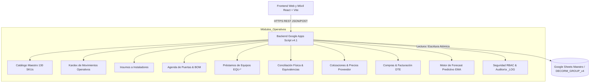
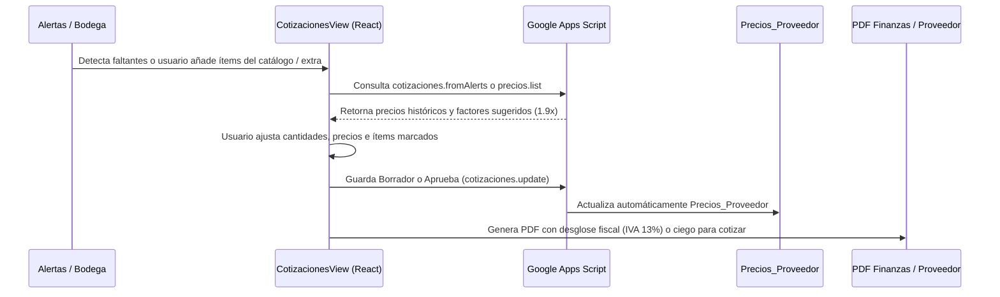

# MANUAL COMPLETO TÉCNICO Y OPERATIVO — SISTEMA MAESTRO DICORMS v4.1
## GRUPO DECORM — Sistema Integral de Inventarios, Abastecimiento Predictivo, Cotizaciones, Producción y Seguridad

---

> **Versión del Sistema:** DICORMS v4.1.0.0 (Clean Code Architecture)  
> **Motor de Forecast:** EMA-1.1 (Exponential Moving Average Adaptativo)  
> **Base de Datos / SSOT:** `DECORM_GROUP_v4.xlsx` (130 SKUs) y Google Sheets API Backend  
> **Frontend:** React 19 + Tailwind CSS + Lucide Icons + Vite  
> **Backend:** Google Apps Script Unificado (`dicorms_backend_unificado_v4.js`)  
> **Jurisdicción Fiscal:** República de El Salvador (Normativa DTE / Ministerio de Hacienda)

---

## 1. INTRODUCCIÓN Y ARQUITECTURA GENERAL

El **Sistema Maestro DICORMS v4.1** es una plataforma empresarial integral diseñada específicamente para **GRUPO DECORM**. Resuelve de forma unificada la desconexión histórica entre el inventario físico en bodegas, el consumo en talleres de producción (Santa Ana, Sonsonate, Taller Central), las cuadrillas de instalación en campo, la programación de pedidos de puertas, las compras a proveedores ferreteros (Freund, Vidrí, etc.) y la planificación financiera de flujo de caja.

### Principios Fundamentales de Diseño
1. **Fuente Única de la Verdad (SSOT):** Los datos maestros residen de forma canónica en la hoja de cálculo en la nube, con respaldo idéntico en el libro Excel `DECORM_GROUP_v4.xlsx`.
2. **Desacoplamiento y Resiliencia:** El frontend React se comunica de forma asíncrona mediante un cliente API con reintentos automáticos, soporte offline para cuadrillas y protección contra pérdidas de red.
3. **Control Criptográfico (RBAC):** Las operaciones de escritura y administración exigen tokens HMAC-SHA256 con tiempo de vida limitado (TTL), sin accesos automáticos de administrador no autorizados.
4. **Gobernanza Rigurosa (SDD-009 v1.1):** Incorpora reglas de negocio blindadas para evitar compras a ciegas, duplicidad de demanda y sobreendeudamiento de herramientas.

---

## 2. CATÁLOGO MAESTRO DE ARTÍCULOS (130 SKUs)

El Catálogo Maestro (`Catalogo`) es el corazón del sistema y gobierna la totalidad de materiales, insumos y herramientas.

### 2.1 Estructura de Clasificación
El universo se divide en 9 categorías estándar y 3 Grupos de Gasto:

| Prefijo SKU | Categoría | Grupo de Gasto | Ejemplo Típico |
| :--- | :--- | :--- | :--- |
| **ABR-*** | Abrasivos | Insumos | `ABR-001` Disco de lija seco 127 mm Pferd grano 80 |
| **CON-*** | Consumibles y EPP | Insumos | `CON-003` Wipe multiuso / `CON-010` Tirro 50 mm |
| **SEL-*** | Selladores y Adhesivos | Insumos | `SEL-001` Silicon transparente / `SEL-002` Masilla |
| **MET-*** | Metal y Estructura | Materia Prima | `MET-001` Tubo industrial cuadrado chapa 16 |
| **VID-*** | Vidrio | Materia Prima | `VID-001` Vidrio templado 6 mm claro |
| **HER-*** | Herrajes y Accesorios | Insumos / Mat. | `HER-001` Bisagra tubular reforzada 3" |
| **EQU-*** | Equipos y Herramientas | Equipos | `EQU-005` Lijadora Roto Orbital 320 W |
| **PIN-*** | Pintura y Recubrimientos | Insumos | `PIN-001` Anticorrosivo negro mate / Thinner |
| **LIV-*** | Construcción Liviana | Materia Prima | `LIV-001` Lámina de yeso / Perfilería tabla roca |
| **EXT-*** | Ítems Extra Fuera de Catálogo | Variable | Materiales especiales comprados para proyectos únicos |

### 2.2 Atributos Clave por Artículo
* **Código SKU Canónico:** Identificador alfanumérico único.
* **Descripción Técnica Completa:** Especificación con marca, medidas, grano o calibre.
* **Stock Físico Inicial (Conteo a Mano):** Columnas `Último conteo físico` y `Fecha conteo` que fijan la realidad auditada de bodega.
* **Stock Actual de Sistema:** Calculado a partir de saldo inicial + entradas por compras − salidas registradas.
* **Stock Mínimo Operativo:** Umbral por debajo del cual se disparan alertas de compra.
* **Precio Medio Ponderado (PMP):** Costo neto calculado dinámicamente con base en las compras reales asociadas a cada SKU.
* **Proveedor Preferido:** Proveedor predeterminado asignado para reposición de stock.

---

## 3. MOTOR DE ABASTECIMIENTO PREDICTIVO & FORECAST (EMA-1.1)

El sistema reemplaza las compras empíricas o basadas en supuestos por un motor matemático que simula la demanda diaria y calcula las necesidades reales de reaprovisionamiento.

### 3.1 Modelo Matemático de Predicción
* **Tasa Diaria Suavizada (EMA):**  
  Calcula el consumo promedio diario mediante Suavizado Exponencial Adaptativo:  
  $$\text{Tasa}_{\text{nueva}} = \text{Tasa}_{\text{anterior}} \cdot (1 - \alpha) + \text{Consumo}_{\text{observado}} \cdot \alpha$$  
  donde el factor de aprendizaje base es $\alpha = 0.20$.
* **Días de Revisión Operativa ($R = 6$ días):**  
  Alineado a la semana operativa de lunes a sábado de los talleres (R-40).
* **Días de Seguridad ($S = 2$ días):**  
  Margen para absorber imprevistos en tiempos de entrega.
* **Stock de Seguridad Dinámico ($SS$):**  
  $$SS = \max\left(\text{Stock Mínimo}, Z \cdot \sigma \cdot \sqrt{LT + R}\right)$$  
  donde $Z = 1.65$ (95% de nivel de servicio logístico) y $LT$ es el Lead Time de entrega del proveedor.
* **Punto de Reorden ($ROP$):**  
  $$ROP = (\text{Tasa Diaria} \cdot LT) + SS$$

### 3.2 Clasificación de Alertas de Desabastecimiento
1. **Nivel ROJO (Agotado o Inminente):** Stock actual $\le 0$ o cobertura estimada $< 2$ días operativos. Requiere cotización y orden urgente.
2. **Nivel NARANJA (En Punto de Reorden):** Posición de inventario $\le ROP$. Se debe incluir en el siguiente ciclo semanal de compras.
3. **Nivel VERDE (Seguro):** Cobertura mayor a 2 semanas. No requiere compra.
4. **Nivel GRIS (Sin Conteo / Mínimo No Definido):** Artículos que requieren auditoría física antes de autorizar órdenes de compra a ciegas (R-39).

---

## 4. MÓDULO DE COTIZACIONES & PRECIOS DE PROVEEDOR

Permite gestionar el ciclo comercial de adquisición de materiales antes de comprometer fondos de la empresa.

### 4.1 Características Principales
* **Generación desde Alertas:** Transforma la lista de insumos críticos del Forecast directamente en una solicitud de cotización con un solo clic.
* **Factor de Pedido (1.9x):** Sugiere automáticamente la cantidad a comprar para cubrir el ciclo operativo más el colchón de seguridad.
* **Manejo Fiscal de El Salvador (R-43):**
  * **Condición SIN IVA:** Para precios netos (como en ferreterías industriales), calculando el +13% de IVA al pie del documento.
  * **Condición CON IVA:** Para compras a consumidor final, desglosando el valor neto y el crédito fiscal.
* **Botón "+ Ítem Fuera de Catálogo":** Permite cotizar materiales atípicos requeridos por un cliente específico (ej. perfiles especiales, vidrios decorativos) asignando un código temporal `EXT-*` y taller de destino.
* **Doble Modalidad de Exportación a PDF:**
  1. **Orden de Compra / Resumen para Finanzas:** Muestra cantidades, precios unitarios pactados, subtotal neto, IVA 13% y total general para liberación de cheques/transferencias.
  2. **Solicitud de Cotización para Proveedores:** Oculta los precios internos y exporta un formato limpio con especificaciones, unidades y cantidades para que el proveedor coloque su oferta.
* **Persistencia Atómica en Hojas:**
  * `Cotizaciones_Cabecera`: Almacena ID, proveedor, destino, fecha, estado (`BORRADOR`, `APROBADA`), notas y totales.
  * `Cotizaciones_Detalle`: Almacena cada línea con su SKU, descripción, cantidad, precio, IVA y estado de selección (`SI`/`NO`).
  * `Precios_Proveedor`: Al aprobar una cotización, el sistema actualiza el historial de precios por proveedor para mantener la inteligencia de costos siempre al día.

---

## 5. COMPRAS Y TRATAMIENTO FISCAL (DTE)

Registra formalmente las entradas de facturas y créditos fiscales de proveedores al sistema.

### 5.1 Reglas Fiscales y Contables (R-43)
* **DTE-03 (Comprobante de Crédito Fiscal):**  
  El costo unitario que alimenta el inventario (PMP) es el valor **Neto** (sin IVA). El 13% se registra como Crédito Fiscal IVA a favor de Grupo DECORM.
* **DTE-01 (Factura de Consumidor Final):**  
  No genera crédito fiscal; el IVA forma parte del costo del material.
* **Percepción del 1% (Grandes Contribuyentes):**  
  Cuando proveedores designados como Grandes Contribuyentes (ej. Freund) aplican la percepción del 1%, este valor **no es costo del producto**; se contabiliza como anticipo de impuesto sobre la renta/IVA.
* **Retención del 1%:**  
  Cuando Grupo DECORM retiene el 1%, constituye un pasivo tributario a declarar ante el Ministerio de Hacienda.
* **Devoluciones a Proveedores:**  
  Exigen la emisión y registro de un **DTE-05 (Nota de Crédito)** para reversar formalmente el inventario y el crédito fiscal.
* **Regla de Capitalización de Activos Fijos:**  
  Toda compra con código `EQU-*` cuyo valor unitario neto sea $\ge \$150.00$ y vida útil estimada $> 1$ año se clasifica como **Activo Fijo** (`ActivosFijos`) y se somete a depreciación; herramientas menores a $\$150.00$ se cargan como gasto directo del mes.

---

## 6. MOVIMIENTOS OPERATIVOS DE INVENTARIO (KARDEX)

Registra cada evento de entrada y salida física de materiales en los talleres de la empresa.

### 6.1 Estructura del Kardex (`MOVIMIENTOSInsumosOperativo`)
Cada movimiento almacena:
* `Fecha`: Fecha contable de la operación (AAAA-MM-DD).
* `Tipo`: `Entrada` (recepción de compras/devolución) o `Salida` (consumo en producción).
* `SKU`: Código del artículo intervenido.
* `Cantidad`: Unidades en positivo (las salidas se descuentan automáticamente del stock).
* `Taller Destino`: Sonsonate, Santa Ana, Taller Central, o Cuadrilla de Instaladores.
* `Entregado A`: Nombre del operador o responsable (nómina cerrada: Josué, Griselda, Jorge Jiménez, Jaime Carbantes, Cristian).
* `Tipo de Referencia`: `PUERTA`, `PROYECTO`, `MANTENIMIENTO_TALLER`.
* `ID de Referencia`: Identificador de la orden o puerta (ej. `DEC-26-001`).
* `Observaciones`: Detalle del destino o trabajo ejecutado.
* `Clave Mes`: Código AAAAMM (ej. `202611`) para segregación financiera de costos mensuales.

### 6.2 Control de Stock Negativo
Si una salida genera un saldo negativo en el catálogo, el sistema emite una advertencia inmediata y registra el caso en las alertas de calidad, permitiendo identificar salidas no documentadas o retrasos en el registro de compras previas.

---

## 7. MÓDULO DE INSUMOS A INSTALADORES

Diseñado para resolver el control de materiales que salen de la bodega central hacia obras exteriores a cargo de los instaladores.

### 7.1 Flujo Operativo y Sincronización Simultánea
1. **Asignación por Lote:** El bodeguero o administrador selecciona el instalador responsable, el taller y los materiales necesarios (silicones, tornillería, lijas, brocas, etc.).
2. **Doble Afectación Inmediata:**
   * **Registro en `InsumosInstaladores`:** Guarda la fila con Lote ID, SKU, cantidad, encargado de bodega y encargado de instalación.
   * **Deducción en `MOVIMIENTOSInsumosOperativo`:** Genera en la misma transacción la salida correspondiente en el Kardex para que el stock de bodega quede rebajado en tiempo real.
3. **Checklist en Terreno:** La cuadrilla puede marcar en su dispositivo móvil los insumos utilizados en obra.

### 7.2 Módulo de Reportes de Instaladores
* **Reporte General (👥):** Exporta el consolidado completo de todos los lotes e insumos entregados en el período a todos los instaladores.
* **Reporte Específico por Operador (📄):** Filtra por instalador (ej. Josué, Jaime) y genera el vale de entrega individual con fecha, descripción, cantidad y espacio para firmas de recibido conforme y Vo.Bo. de Administración.

---

## 8. AGENDA DE PUERTAS & BOM DE PRODUCCIÓN

Coordina el plan de fabricación del producto insignia de Grupo DECORM con el consumo de insumos de taller.

### 8.1 Agenda de Pedidos (`AgendaDePuertas`)
Lleva el control de cada puerta comprometida con clientes:
* `SKU Puerta`: Identificador de la orden (ej. `DEC-26-001`).
* `Cliente`: Nombre del cliente o proyecto.
* `Modelo`: Tipo de puerta (ej. Vidrio Templado, Puerta Plegable, Puerta Rústica, Batiente).
* `Taller`: Taller asignado para el armado.
* `Día Entrega`: Fecha límite de entrega/instalación.
* `Estado`:
  * `Por fabricar` (crea demanda de materiales)
  * `Programado` (crea demanda de materiales)
  * `En proceso` (crea demanda de materiales)
  * `En confirmación` (**NO crea demanda** según regla R-16 y R-39 hasta confirmación de anticipo)
  * `Terminado` / `Entregado` / `Instalado` (demanda cerrada)

### 8.2 Lista de Materiales (`BOM_Puertas`)
Define la "receta" estándar de insumos consumidos por cada modelo de puerta (ej. discos de lija, masilla, sellador, perfiles). El motor de Forecast cruza las puertas activas con el BOM para reservar insumos con anticipación y evitar paradas de producción.

---

## 9. PRÉSTAMOS DE EQUIPOS Y HERRAMIENTAS

Control estricto de las herramientas eléctricas, neumáticas y de mano asignadas a los trabajadores.

### 9.1 Control de Custodia (`PrestamosEquipos`)
* Aplica exclusivamente a artículos con prefijo **`EQU-*`** (taladros, lijadoras, esmeriles, pistolas de pintar).
* Registra ID de préstamo correlativo (`PR-0001`), persona responsable, fecha de salida, fecha límite pactada de entrega y estado (`ACTIVO`, `DEVUELTO`, `VENCIDO`).
* Permite registrar devoluciones parciales o totales con actualización de saldo pendiente.

### 9.2 Regla de Bloqueo Automático R-32 (SDD-009)
* **Bloqueo de Morosos:** Si un trabajador tiene herramientas con plazo de devolución vencido y saldo pendiente $> 0$, el sistema **bloquea automáticamente la creación de un nuevo préstamo** para esa persona.
* **Mecanismo de Excepción:** Únicamente se puede desbloquear con la casilla de *Autorización Expresa de Gerencia* debidamente justificada.

---

## 10. CONCILIACIÓN FÍSICA & EQUIVALENCIAS

Cruce sistemático de auditoría entre el inventario físico contado en bodega y los saldos del sistema.

### 10.1 Matriz de Equivalencias (`Equivalencias`)
Mapea los códigos rápidos y jerga de taller (`INS-001` a `INS-013`) con los SKUs maestros del catálogo:
* Ejemplo: `INS-001` $\rightarrow$ `ABR-001` (Disco de lija 80 Pferd).
* Factor de desglose: Permite transformar unidades de compra a unidades de consumo (ej. cajas a unidades, rollos a metros).

### 10.2 Conciliación de Inventario (`Conciliacion`)
* Cruza `Stock Físico` (conteo) vs `Stock Sistema`.
* Calcula la diferencia absoluta y porcentual.
* Estados de Conciliación:
  * **CUADRA:** Diferencia dentro de la tolerancia permitida ($0$ para unidades cerradas; $\pm 3\%$ para graneles/químicos).
  * **FALTANTE:** Físico $<$ Sistema (posible merma, consumo no registrado o robo).
  * **SOBRANTE:** Físico $>$ Sistema (compra no ingresada o error de conteo).
  * **SIN CONTEO:** Artículos pendientes de censo físico.
* **Regla R-41 (Ajuste Contable):** Los ajustes resultantes de la conciliación física se registran como movimientos contables con marca `afecta_stock = NO` para no duplicar ni distorsionar los movimientos ya consolidados por el conteo.

---

## 11. TABLERO DE CONTROL (DASHBOARD) & CALIDAD R-46

Centro de comando visual para la toma de decisiones gerenciales y operativas.

### 11.1 Indicadores Clave de Desempeño (KPIs)
* **Gasto del Mes:** Sumatoria de compras realizadas en el período seleccionado.
* **Valor del Inventario:** Valorización total del stock en bodega a costo PMP.
* **Artículos a Comprar:** Total de SKUs cuya posición de inventario está en o por debajo de su punto de reorden.
* **Artículos Agotados:** SKUs en stock cero o negativo con impacto directo en taller.
* **Consumo Mensual:** Unidades consumidas por semana y por taller.

### 11.2 Alertas de Calidad de Datos (R-46)
Monitorea continuamente la salud del sistema y detecta anomalías:
1. Compras registradas sin proveedor o en estado "Pendiente".
2. Compras con precio unitario pagado igual a $\$0.00$.
3. Facturas sin tipo de DTE asignado.
4. Artículos en el Catálogo sin stock mínimo configurado.
5. Artículos sin proveedor preferido asignado.
6. Artículos con stock actual negativo en bodega.
7. Movimientos de salida sin taller destino especificado.
8. Puertas en la agenda sin taller de fabricación asignado.

---

## 12. SEGURIDAD, ROLES Y GOBERNANZA (RBAC)

El sistema implementa un modelo de seguridad por capas para proteger la información comercial y financiera.

### 12.1 Matriz de Control de Acceso por Roles (RBAC)

| Módulo / Acción | Admin | Compras | Bodega | Taller | Lectura |
| :--- | :---: | :---: | :---: | :---: | :---: |
| **Catálogo (Ver / Editar)** | ✅ / ✅ | ✅ / ❌ | ✅ / ❌ | ✅ / ❌ | ✅ / ❌ |
| **Compras (Registrar / Ver)** | ✅ / ✅ | ✅ / ✅ | ❌ / ✅ | ❌ / ❌ | ❌ / ✅ |
| **Cotizaciones (Crear / Aprobar)** | ✅ / ✅ | ✅ / ✅ | ❌ / ❌ | ❌ / ❌ | ❌ / ❌ |
| **Movimientos (Salidas / Entradas)** | ✅ / ✅ | ❌ / ❌ | ✅ / ✅ | ✅ (Ver) | ❌ / ✅ |
| **Insumos Instaladores (Despacho)** | ✅ / ✅ | ❌ / ❌ | ✅ / ✅ | ✅ (Ver) | ❌ / ✅ |
| **Puertas & BOM (Planificar)** | ✅ / ✅ | ❌ / ✅ | ❌ / ✅ | ✅ (Ver) | ❌ / ✅ |
| **Préstamos EQU-* (Crear / Devolver)** | ✅ / ✅ | ❌ / ❌ | ✅ / ✅ | ❌ / ❌ | ❌ / ✅ |
| **Forecast Predictivo (Ver / Plan)** | ✅ / ✅ | ✅ / ✅ | ❌ / ❌ | ❌ / ❌ | ❌ / ❌ |
| **Actualizar Contraseñas / PINs** | **Solo Cristian** | ❌ | ❌ | ❌ | ❌ |

### 12.2 Autenticación y Gestión de Credenciales (R-47)
* **Algoritmo:** HMAC-SHA256 con salt dinámico y token criptográfico firmado.
* **Política de Intentos:** 5 intentos fallidos consecutivos bloquean la cuenta por 15 minutos automáticamente.
* **Sin Accesos Automáticos Inseguros:** Se suprimió cualquier comodín que otorgara permisos de administrador sin credenciales. Las peticiones no autenticadas se limitan a estado de invitado sólo lectura.
* **Administrador Exclusivo:** Únicamente **Cristian Cajul** tiene la facultad de modificar, asignar o restablecer PINs de acceso para cualquier usuario del sistema mediante el modal de seguridad dedicado (icono 🔑).

---

## 13. MAPEO TÉCNICO DE TABLAS Y HOJAS DE CÁLCULO

El backend unificado interactúa con 17 hojas maestras y 3 hojas internas del sistema:

| Nombre de Hoja | Función Principal | Llave Primaria (PK) |
| :--- | :--- | :--- |
| `Inicio` | Carátula y KPIs ejecutivos calculados por fórmulas | N/A |
| `Resumen` | Tablero de control operativo, consumos semanales y alertas | N/A |
| `Catalogo` | Base canónica de los 130 SKUs, costos y existencias | `sku` |
| `Precios_Proveedor` | Historial de precios de compra por proveedor y SKU | `id_precio` (`PROV\|SKU`) |
| `Cotizaciones_Cabecera` | Registro de solicitudes y órdenes de cotización | `cotizacion_id` |
| `Cotizaciones_Detalle` | Desglose línea por línea de cada cotización | `cotizacion_id` + `SKU` |
| `Plantilla_Cotizacion` | Formato maestro de visualización e impresión | N/A |
| `Compras` | Libro de compras, facturas y créditos fiscales (DTE) | `id_compra` |
| `MOVIMIENTOSInsumosOperativo`| Kardex oficial de entradas y salidas de inventario | `mov_uid` |
| `InsumosInstaladores` | Asignaciones de materiales a cuadrillas de campo | `uid` / `Lote ID` |
| `AgendaDePuertas` | Programación y estado de fabricación de puertas | `sku_puerta` |
| `BOM_Puertas` | Receta de materiales requeridos por modelo de puerta | `modelo` + `sku` |
| `PrestamosEquipos` | Registro de custodia y mora de herramientas `EQU-*` | `id_prestamo` |
| `Conciliacion` | Cruce entre inventario físico manual y teórico | `SKU` |
| `Equivalencias` | Mapeo entre códigos `INS-*` y SKUs maestros | `id_equivalencia` |
| `GASTO_MES` | Matriz de costos mensuales por categoría de gasto | `clave_mes` |
| `Config` | Parámetros globales del taller y tolerancias | `clave` |
| `_USERS` | Credenciales, roles, salts y estados de bloqueo | `username` |
| `_SEQ` | Generador atómico de números correlativos | `Clave` |
| `_LOG` | Bitácora de auditoría inmutable de todas las mutaciones | Timestamp |

---

## 14. GUÍA RÁPIDA DE OPERACIÓN DIARIA

### Rutina Matutina (07:00 AM - 08:00 AM)
1. **Conteo Físico Rápido (Bodega):** Verificar los 38 SKUs de alta rotación antes de autorizar despachos.
2. **Revisión de Alertas de Abastecimiento:** Compras ingresa al Centro de Alertas y verifica ítems en Nivel ROJO o NARANJA.
3. **Generación de Cotización del Día:** Pulsar `Generar Cotización` desde las alertas, verificar precios de proveedor y exportar el PDF para autorización.

### Rutina de Despacho a Producción e Instaladores
1. **Despacho a Talleres:** Cada salida debe tener su responsable y número de puerta asignado (`DEC-26-xxx`).
2. **Despacho a Instaladores:** Utilizar la vista `Instaladores`, cargar el lote de insumos y registrar la entrega. El sistema rebaja automáticamente el stock de bodega central.
3. **Control de Herramientas:** Si el operario tiene préstamos vencidos, liquidar la devolución antes de entregar un nuevo equipo `EQU-*`.

### Cierre Semanal (Sábados)
1. Exportar el **Reporte Consolidado de Instaladores** para cuadre de cuadrillas.
2. Revisar la pestaña **Calidad de Datos (R-46)** en el Dashboard para corregir registros incompletos.
3. Respaldar el libro maestro `DECORM_GROUP_v4.xlsx`.

---
*Documento generado conforme a las especificaciones técnicas y operativas del Sistema Maestro DICORMS v4.1 — Grupo DECORM.*
