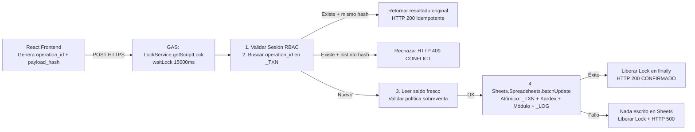

# Software Design Document (SDD) — DICORMS v4.2
## Remediación de Integridad Transaccional, Contable-Fiscal, Abastecimiento Predictivo y Seguridad

**Organización:** Grupo DECORM (El Salvador)  
**Sistema:** DICORMS (Evolución v4.1.0.0 → v4.2.0.0)  
**Arquitectura Base:** React 19 + Vite + Google Apps Script + Google Sheets (SSOT)  
**Fecha:** 2026-11-22  
**Autor:** Ingeniería de Sistemas / CreaPx  
**Estado:** Especificación Aprobada para Implementación  

---

## 1. Resumen Ejecutivo y Diagnóstico de Brechas

Este documento consolida y afina la propuesta de corrección técnica para **DICORMS v4.1**, integrando las observaciones de ingeniería (eliminación del factor fijo `1.9x` y atomicidad en despachos) con las brechas críticas de **integridad contable, cumplimiento fiscal salvadoreño, control de compras y seguridad** identificadas tras auditar el libro real `DECORM_GROUP_v4.xlsx` y el `MANUAL_COMPLETO_SISTEMA_DICORMS_V4.md`.

Se mantiene la arquitectura **React 19 + Google Apps Script + Google Sheets** (adecuada para el catálogo actual de 130 SKUs), pero se elevan cinco estándares de arquitectura a **reglas obligatorias de servidor** ejecutadas en el siguiente orden de prioridad:

| Fase | Regla SDD | Alcance | Criticidad |
| :--- | :--- | :--- | :--- |
| **Fase 1** | **SDD-011 (Ampliado)** | Integridad transaccional en **todas** las mutaciones de stock, Kardex único y política de sobreventa | **Crítica** |
| **Fase 2** | **SDD-012** | PMP perpetuo (NIIF/NIC 2), Percepción 1% IVA (Art. 163 CT), control de DTE pendientes y cruce de 3 vías | **Crítica** |
| **Fase 3** | **SDD-010 (Afinado)** | Motor de abastecimiento por demanda real (sin `1.9x`), OC en tránsito (`IP`), ABC y arranque en frío | **Alta** |
| **Fase 4** | **SDD-013** | Libro en solo lectura, endurecimiento de credenciales y eliminación de punto único de falla (SPOF) | **Media** |
| **Fase 5** | **Unificación v4.2** | Alineación de esquema (27+ hojas, 4 grupos de gasto, catálogos cerrados) y Manual v4.2 | **Media** |

### 1.1 Hallazgos Auditados en `DECORM_GROUP_v4.xlsx`

La inspección directa del libro maestro vigente confirma seis defectos estructurales que este SDD resuelve:

1. **Riesgo de doble conteo y tipos inconsistentes en Kardex:** `Catalogo!K` suma `Compras!G` y `Catalogo!L` suma `MOVIMIENTOSInsumosOperativo` (`Devolución` + `Ajuste (+)`), mientras el Manual v4.1 §6.1 define `Entrada` en el Kardex. Además, la hoja `_LOG` (2026-11-22 18:01) evidencia registros creados por el módulo de instaladores con `tipo = "Salida (Entrega a Taller)"` e `id = "MOV-0107"` repetido cuatro veces.
2. **PMP no perpetuo:** `Catalogo!U` calcula `SUMIFS(Compras!J) / SUMIFS(Compras!G)`, ignorando el `Stock inicial` (`Catalogo!I`) y el efecto de las salidas intermedias.
3. **Compras en tránsito inexistentes:** `Catalogo!AA` (`En tránsito / Cot.`) suma `Cotizaciones_Detalle` en estado `APROBADA` o `ENVIADA`, sin una entidad `OrdenesCompra` que descuente recepciones parciales.
4. **Historial insuficiente para EMA:** `Consumption_Learning` tiene apenas 11 SKUs con `observaciones_validas = 1` y `confianza = BAJA`, insuficiente para calibrar $\sigma_d$ o tasas EMA confiables.
5. **Exposición fiscal en `Compras`:** 51 de 59 líneas de noviembre aparecen con `Tipo de DTE = Pendiente` (capitalizando el IVA en `Costo neto $`) y proveedor `Por asignar`, sin bloqueo al vencer `DIAS_MAX_DTE_PENDIENTE = 5` (`Config!Q9`).
6. **Contradicciones documentales:** El libro real tiene 27 hojas (el Manual lista 20), 4 grupos de gasto reales (`Insumos`, `Materia prima`, `Herrajes y accesorios`, `Equipos y herramientas`) frente a "3" declarados en el Manual §2.1, y usa prefijos `CLI-*` / `GEN-*` en lugar de `LIV-*` / `EXT-*`.

---

## 2. SDD-011 (Ampliado): Integridad Transaccional y Libro Único de Existencias

### 2.1 Principio de Libro Único (Single Source of Truth de Stock)

**Regla:** `MOVIMIENTOSInsumosOperativo` es la **única** fuente de verdad para calcular existencias físicas (`STOCK ACTUAL`). **Ninguna** otra hoja (`Compras`, `InsumosInstaladores`, `Conciliacion`, `PrestamosEquipos`) puede sumar o restar directamente del saldo del catálogo.

* **Recepción de Compras:** Al confirmar una recepción en `RecepcionesBodega` / `Compras`, el backend genera atómicamente una fila `Tipo = "Entrada (Compra)"` en `MOVIMIENTOSInsumosOperativo`.
* **Despacho a Instaladores:** El módulo `InsumosInstaladores` registra únicamente la custodia y detalle de entrega por cuadrilla/obra, y en la **misma transacción atómica** inserta las líneas `Tipo = "Salida (Instalador)"` en `MOVIMIENTOSInsumosOperativo`.
* **Fórmula unificada en `Catalogo`:**
  * `Entradas [Auto]` = `SUMIFS(MOVIMIENTOS, Tipo IN {"Entrada (Compra)", "Devolución", "Ajuste (+)"})`
  * `Salidas [Auto]` = `SUMIFS(MOVIMIENTOS, Tipo IN {"Salida (Taller)", "Salida (Instalador)", "Ajuste (-)"})`
  * `Stock Teórico [Auto]` = `Stock_Inicial + Entradas - Salidas`

### 2.2 Cobertura Obligatoria (Todas las Operaciones de Inventario)

Toda mutación que afecte existencias debe pasar por el motor transaccional unificado `InventoryTxEngine`:
1. Despachos a instaladores (`OP-INS-...`)
2. Salidas y devoluciones de talleres (`OP-MOV-...`)
3. Recepciones de compras (`OP-REC-...`)
4. Ajustes de conciliación física (`OP-ADJ-...`)
5. Préstamos y retornos de equipos `EQU-*` (`OP-PR-...`)

### 2.3 Arquitectura de Tres Niveles



#### Nivel 1: Identificador Único e Idempotencia Persistente (`_TXN`)
* **Formato de `operation_id`:** `OP-<MOD>-<AAAAMMDD>-<NNNNNN>` (ej. `OP-INS-20261122-000001`), generado en React al confirmar la acción (nunca regenerado en reintentos de red) y acompañado por `mov_uid` único por cada línea de movimiento.
* **Almacenamiento persistente:** Se crea la hoja `_TXN` en Google Sheets (no se usa `CacheService` para idempotencia porque expira y no es durable).
* **Estructura de `_TXN`:**

| Columna | Tipo | Descripción |
| :--- | :--- | :--- |
| `operation_id` | String (PK) | Identificador único irrepetible de la operación |
| `modulo` | Enum | `INSTALADORES`, `MOVIMIENTOS`, `COMPRAS_REC`, `AJUSTE`, `PRESTAMOS` |
| `payload_hash` | String (SHA-256) | Hash canónico de SKUs, cantidades, taller y referencia |
| `estado` | Enum | `CONFIRMADO`, `STOCK_NEGATIVO_OFFLINE`, `RECHAZADO` |
| `usuario` | String | Usuario autenticado que ejecutó la operación |
| `respuesta_json` | JSON | Payload exacto devuelto al cliente para reintentos idempotentes |
| `created_at` | ISO-8601 | Marca de tiempo del servidor |

* **Regla de idempotencia:** Si `operation_id` ya existe en `_TXN`:
  * Si `payload_hash` coincide: retornar `respuesta_json` almacenada sin crear movimientos nuevos.
  * Si `payload_hash` difiere: rechazar con `409 CONFLICT` y registrar intento en `_LOG`.

#### Nivel 2: Bloqueo de Concurrencia (`LockService`)
Se utiliza [`LockService.getScriptLock()`](https://developers.google.com/apps-script/reference/lock/lock-service) en Google Apps Script con `tryLock(15000)`. La lectura de inventario disponible, la validación de stock y el envío del lote atómico ocurren **estrictamente dentro** del bloque `try { ... } finally { lock.releaseLock(); }`.

#### Nivel 3: Escritura Atómica con Servicio Avanzado de Sheets API v4
`SpreadsheetApp.appendRow()` no es atómico entre múltiples hojas, y `spreadsheets.values.batchUpdate` solo actualiza rangos existentes. Por ello, se habilita el **Servicio Avanzado de Google Sheets API v4** (`Sheets`) y se utiliza [`Sheets.Spreadsheets.batchUpdate`](https://developers.google.com/workspace/sheets/api/reference/rest/v4/spreadsheets/batchUpdate) con solicitudes `appendCells` (y `updateCells` cuando se actualice saldo/PMP en `Catalogo`):

```javascript
// Patrón obligatorio en 04_RepoSheets.gs (Apps Script + Sheets API v4)
function commitAtomicTransaction(spreadsheetId, requests) {
  // Si cualquier AppendCellsRequest o UpdateCellsRequest falla en validación,
  // la API garantiza que NINGUNA escritura se aplica al libro.
  const response = Sheets.Spreadsheets.batchUpdate(
    { requests: requests },
    spreadsheetId
  );
  return response;
}
```

### 2.4 Política de Sobreventa (Resolución de Decisión D-4 / Regla 6.2)

Se resuelve la contradicción entre "no permitir sobreventa" y `BLOQUEAR_NEGATIVO = FALSE`:

| Escenario | Política del Backend | Estado Resultante |
| :--- | :--- | :--- |
| **Operación en línea (Bodega / Taller)** | **Bloqueo estricto:** si `stock_actual < cantidad`, se rechaza la operación (`HTTP 422 INSUFFICIENT_STOCK`). | No se escribe movimiento |
| **Operación Offline (Cuadrilla en campo)** | **Permitida con bandera `offline_override = true`:** la entrega física ya ocurrió en sitio; se registra la salida, se marca `estado = STOCK_NEGATIVO_OFFLINE` en `_TXN` y se emite alerta crítica en Dashboard para ajuste/regularización en 24 h. | Registrado + Alerta Roja |

---

## 3. SDD-012: Integridad Contable (PMP Perpetuo) y Cumplimiento Fiscal (El Salvador)

### 3.1 Costeo por Promedio Móvil Ponderado Perpetuo (NIC 2 / NIIF)

Se reemplaza el promedio simple histórico en `Catalogo!U` por un **PMP perpetuo** calculado por el backend en cada movimiento de entrada (`Entrada (Compra)` o `Ajuste (+)` valorizado) y almacenado en `Catalogo` junto con el `Valor_Total_Inventario`:

* **En cada Entrada ($Q_{\text{ent}} > 0$ a costo neto unitario $C_{\text{neto}}$):**
  * Si $Q_{\text{actual}} > 0$:
    $$\text{PMP}_{\text{nuevo}} = \frac{(Q_{\text{actual}} \times \text{PMP}_{\text{actual}}) + (Q_{\text{ent}} \times C_{\text{neto}})}{Q_{\text{actual}} + Q_{\text{ent}}}$$
  * Si $Q_{\text{actual}} \le 0$ (regularización desde cero o negativo):
    $$\text{PMP}_{\text{nuevo}} = C_{\text{neto}}$$
* **En cada Salida:** Se valora al $\text{PMP}_{\text{actual}}$ vigente **sin modificar el PMP**, guardando el campo `costo_unit_pmp` y `costo_total` inmutables en cada fila de `MOVIMIENTOSInsumosOperativo` para preservar el costo histórico mensual (`GASTO_MES`).
* **En Devoluciones de Taller/Obra:** Reingresan al $\text{PMP}$ del movimiento original (o $\text{PMP}_{\text{actual}}$ si no hay referencia), recalculando el promedio ponderado.

### 3.2 Tratamiento Fiscal de DTE y Percepción del 1% (Código Tributario)

Se corrige el Manual v4.1 §5.1: la percepción del 1% aplicada por Grandes Contribuyentes (conforme al [Art. 163 del Código Tributario de El Salvador](https://transparencia.mh.gob.sv/downloads/pdf/DC5920_12101-OPJ-0272-2005.PDF)) es **IVA Percibido (anticipo de IVA)** y **nunca** anticipo de Impuesto sobre la Renta (ISR) ni costo del inventario.

* **Parámetros en `Config`:** `UMBRAL_PERCEPCION_IVA = 100.00` (base neta mínima; confirmar umbrales vigentes con contador), `TASA_PERCEPCION = 0.01`, `TASA_RETENCION = 0.01`.
* **Asiento contable estándar para compra CCF (DTE-03) de $100.00 neto a Gran Contribuyente:**

| Cuenta Contable | Debe ($) | Haber ($) | Tratamiento en DICORMS |
| :--- | :---: | :---: | :--- |
| **Inventarios – Insumos / Materia Prima** | 100.00 | — | Alimenta PMP perpetuo |
| **IVA Crédito Fiscal (13%)** | 13.00 | — | Libro de Compras IVA |
| **IVA Percibido 1% (Anticipo de IVA)** | 1.00 | — | No capitalizable al costo |
| **Cuentas por Pagar – Proveedor** | — | 114.00 | Pasivo total a pagar |
| **Totales** | **114.00** | **114.00** | |

### 3.3 Control de Compras sin DTE y Recálculo Retroactivo de PMP

Para eliminar la exposición fiscal actual (51 líneas pendientes en noviembre):
1. Al registrar una compra con `Tipo de DTE = Pendiente`, el sistema calcula automáticamente `fecha_limite_dte = fecha_compra + 5 días hábiles` (`DIAS_MAX_DTE_PENDIENTE`).
2. Mientras esté `Pendiente`, el monto pagado se registra como costo provisional sin crédito fiscal y genera una alerta amarilla en Dashboard.
3. Si supera `fecha_limite_dte` sin regularización, cambia a `VENCIDO_NO_DEDUCIBLE` (alerta roja financiera y bloqueo de nuevas OC al proveedor si es recurrente).
4. **Reclasificación y Recálculo Retroactivo:** Cuando se ingresa el DTE-03 (CCF) definitivo, el sistema separa el 13% de IVA Crédito Fiscal (y 1% de IVA Percibido si aplica), reduce el `costo_neto` de esa línea y **ejecuta automáticamente el recálculo cronológico del PMP** para ese SKU desde la fecha de la compra regularizada hasta el saldo actual.

### 3.4 Cruce de Tres Vías (3-Way Match) y Segregación de Funciones

Se separan las responsabilidades mediante dos nuevas hojas maestras: `OrdenesCompra` y `RecepcionesBodega`:

1. **Orden de Compra (`OrdenesCompra` — Rol `Compras`):** Nace desde una cotización aprobada (`COT-*`). Genera `oc_id` (`OC-26-NNNN`), proveedor, SKUs, `cant_pedida`, precios pactados y estado (`EMITIDA`, `PARCIAL`, `RECIBIDA_COMPLETA`, `CERRADA`).
2. **Recepción Física (`RecepcionesBodega` — Rol `Bodega`):** El bodeguero recibe físicamente la mercadería contra la `oc_id` registrando `cant_recibida` (sin facultad de alterar precios ni DTE). Esta acción dispara la entrada en `MOVIMIENTOSInsumosOperativo` y actualiza `cant_recibida` en `OrdenesCompra`.
3. **Validación Fiscal (`Compras` — Rol `Finanzas / Admin`):** Concilia la `recepcion_id` contra el DTE emitido por el proveedor (`N.º DTE`, tipo, percepción/retención) y habilita el pago.

---

## 4. SDD-010 (Afinado): Motor de Abastecimiento Inteligente

### 4.1 Eliminación del Multiplicador Fijo `1.9x`

Se suprime `FACTOR_PEDIDO = 1.9` de `Config`, `Resumen` y `Catalogo`, así como `factor_reposicion` de `Forecast_Config`. Toda sugerencia de compra se calcula mediante revisión periódica ($R = 6$ días operativos de lunes a sábado, corrigiendo el valor `7` actual en `Forecast_Config!REVISION_DIAS`) y nivel objetivo $S$:

$$P = LT + R$$

$$SS = \max\left(\text{StockMinimo},\ Z_{\text{clase}} \times \sigma_d \times \sqrt{LT + R}\right)$$

$$S = \left(d \times (LT + R)\right) + D_{\text{BOM}} + SS$$

$$Q = \max\left(0,\ S - IP\right)$$

$$Q_{\text{compra}} = \begin{cases} 0 & \text{si } Q = 0 \\ \left\lceil \dfrac{Q}{\text{empaque}} \right\rceil \times \text{empaque} & \text{si } Q > 0 \end{cases}$$

Donde:
* $d$: Consumo diario promedio recurrente (excluyendo consumos con `ref_tipo = 'PUERTA'` para evitar doble conteo).
* $D_{\text{BOM}}$: Demanda neta de `BOM_Puertas` para puertas en `AgendaDePuertas` con estado `Por fabricar`, `Programado` o `En proceso` (excluyendo `En confirmación`).
* $IP$ (**Inventario Proyectado**): $\text{Stock\_Actual} + \sum (\text{OC abierta: } \text{cant\_pedida} - \text{cant\_recibida})$. **No** incluye cotizaciones en borrador.

### 4.2 Reglas de Madurez Estadística, Segmentación ABC y Demanda Intermitente

Para evitar errores estadísticos con historial corto o consumos esporádicos:

| Condición del SKU | Clasificación / Regla | Método de Cálculo de $S$ |
| :--- | :--- | :--- |
| **Historial $< 24$ observaciones válidas** (~8–12 semanas) | **Modo Bootstrap (Arranque en Frío)** | Se desactiva EMA para compra automática: $S = \text{StockMinimo} + D_{\text{BOM}}$. |
| **Consumo continuo ($\ge 24$ obs., $ADI < 1.32$, $CV^2 < 0.49$)** | **Demanda Regular (EMA + ABC)** | Fórmula completa con EMA ($\alpha = 0.20$), $\sigma_d$ móvil y nivel de servicio ABC: **Clase A** $Z=2.05$ (98%), **Clase B** $Z=1.65$ (95%). |
| **Consumo intermitente/errático** (ej. `HER-*`, `SEL-*`, `PIN-*`) | **Demanda Intermitente (SBA / Min-Max)** | Aproximación Syntetos-Boylan (SBA) sobre intervalo entre demandas o política **Min-Max + $D_{\text{BOM}}$**; para **Clase C** (bajo impacto anual) se usa Min-Max simple. |

### 4.3 Transparencia en la Interfaz (`CotizacionesView`)

Cada línea sugerida en el módulo de cotizaciones mostrará el desglose auditado:
`Stock Actual` + `En Tránsito (OC)` = `IP` | `Demanda Período d×(LT+R)` + `Demanda BOM` + `SS` = `Objetivo S` | `Calculado Q` → `Ajustado a Empaque`.

---

## 5. SDD-013: Endurecimiento de Seguridad y Gobernanza

1. **Control de Acceso al Libro Google Sheets:** Todos los usuarios operativos (Bodega, Taller, Compras) tendrán permiso de **Solo Lectura** (o sin acceso directo) sobre el archivo de Google Sheets. El Web App de Google Apps Script se desplegará con **"Ejecutar como: Yo (propietario)"** y **"Quién tiene acceso: Cualquier usuario"** (protegido por token de sesión firmado + validación de origen), garantizando que **ningún humano pueda editar saldos o Kardex manualmente**.
2. **Fortalecimiento de Credenciales (`_USERS`):** Se reemplaza el PIN de 6 dígitos con SHA-256 simple por contraseña/PIN de mínimo 8 caracteres alfanuméricos derivado con **PBKDF2-HMAC-SHA256** (10,000 iteraciones y salt único de 16 bytes por usuario), manteniendo el bloqueo de 15 minutos tras 5 intentos fallidos.
3. **Eliminación de SPOF de Administrador:** Se habilitan al menos **dos** cuentas con rol `admin_seguridad` (ej. Cristian Cajul + cuenta de respaldo gerencial custodiada) facultadas para restablecer credenciales, registrando cada cambio en `_LOG`.

---

## 6. Unificación Documental y Esquema Canónico (DICORMS v4.2)

Para eliminar las contradicciones entre el Manual v4.1 y `DECORM_GROUP_v4.xlsx`, el esquema oficial v4.2 fija los siguientes estándares únicos:

| Dimensión | Estándar Canónico DICORMS v4.2 |
| :--- | :--- |
| **Hojas Maestras** | 27 hojas actuales + 3 nuevas (`_TXN`, `OrdenesCompra`, `RecepcionesBodega`) = **30 hojas**. |
| **Grupos de Gasto (4)** | `Insumos`, `Materia prima`, `Herrajes y accesorios`, `Equipos y herramientas`. |
| **Prefijos de SKU** | `ABR-*`, `CON-*`, `SEL-*`, `MET-*`, `VID-*`, `CLI-*` (Construcción Liviana), `HER-*`, `PIN-*`, `EQU-*`, `GEN-001..004` (Sin detalle). |
| **Tipos de Kardex Cerrados** | `Entrada (Compra)`, `Devolución`, `Ajuste (+)`, `Salida (Taller)`, `Salida (Instalador)`, `Ajuste (-)`. |
| **Estados de Puerta Cerrados** | `En confirmación` (no genera demanda), `Por fabricar`, `Programado`, `En proceso` (generan $D_{\text{BOM}}$), `Listo para entrega`, `Entregada`, `Cancelada`. |

---

## 7. Plan de Pruebas de Aceptación (QA Obligatorio)

El pase a producción de DICORMS v4.2 queda condicionado a superar las siguientes 12 pruebas automatizadas y de integración:

| ID | Caso de Prueba | Resultado Esperado |
| :--- | :--- | :--- |
| **QA-01** | Reenvío idéntico de despacho (`operation_id` + mismo `payload_hash`) | Retorna confirmación original; 0 filas nuevas en Kardex o `_TXN`. |
| **QA-02** | Pérdida de red post-confirmación y reintento automático offline | Frontend conserva `operation_id` y recupera `CONFIRMADO` sin duplicar salida. |
| **QA-03** | Mismo `operation_id` con cantidades modificadas | Rechazo `HTTP 409 CONFLICT` y registro en `_LOG`. |
| **QA-04** | Dos bodegueros solicitan simultáneamente las últimas unidades | `LockService` serializa; primero confirma, segundo recibe `HTTP 422`. |
| **QA-05** | Despacho offline cuando no hay stock en línea | Se registra con `STOCK_NEGATIVO_OFFLINE` y dispara alerta roja en Dashboard. |
| **QA-06** | Fallo simulado en la 3.ª solicitud de `Spreadsheets.batchUpdate` | Atomicidad total: 0 filas escritas en `_TXN`, Kardex, Módulo y `_LOG`. |
| **QA-07** | Usuario con rol `Lectura` o `Taller` intenta mutar stock o abrir Sheets para editar | Rechazo `HTTP 403` en API y bloqueo de edición en Google Sheets. |
| **QA-08** | Compra con `Stock inicial = 100 @ $2.00` + compra `100 @ $1.00` | PMP perpetuo resulta exactamente `$1.50` (y no `$1.00`). |
| **QA-09** | Compra CCF `$100` neto con Percepción 1% | Inventario `$100.00`, IVA CF `$13.00`, IVA Percibido `$1.00`, CxP `$114.00`. |
| **QA-10** | Regularización de compra `Pendiente` al recibir CCF | Separa IVA CF y recalcula retroactivamente el PMP del SKU desde la fecha original. |
| **QA-11** | Recepción parcial de `OrdenesCompra` (50 de 100 u) | `IP` descuenta a 50 u en tránsito; Kardex suma 50 u una sola vez. |
| **QA-12** | Cálculo de compra para SKU con $< 24$ obs. vs. SKU maduro con BOM | SKU nuevo usa `StockMinimo + D_BOM` (sin EMA); SKU maduro usa $S$ con desglose completo. |
